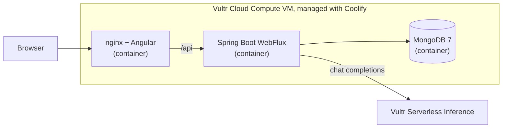

# Reconcile Agent

An AI agent for finance teams that **reads supplier invoices, reconciles them against the bank statement and flags what needs a human decision**. Nothing is approved automatically: every anomaly waits for a person to approve or reject it.

Built for the **Vultr: Agent Rush Hackathon**, challenge 2 (*Powering the Future of Work*), focus area **Finance & Accounting**: process invoices, reconcile transactions, flag anomalies.

**Live demo:** http://htrydpwne1riejjb6jqt5s1h.64.177.59.13.sslip.io

## What it does

1. The user uploads up to 30 invoice PDFs and one bank statement CSV.
2. An LLM reads every invoice and extracts supplier, number, amount, currency and issue date.
3. Deterministic rules reconcile invoices with bank payments and detect anomalies.
4. The user reviews each anomaly in an approval queue and approves or rejects it.

The agent executes real work on real documents: the numbers on screen come from the uploaded files, stored in MongoDB, and every decision is persisted.

## Architecture



## How Vultr powers the solution

| Vultr service | How we use it |
| --- | --- |
| **Cloud Compute VM** | One VM (2 vCPU, 4 GB RAM, 100 GB NVMe, Ubuntu 26.04, Atlanta) runs the whole platform: the backend, the frontend and the database. Vultr is the central backend, not static hosting. |
| **Serverless Inference** | The OpenAI-compatible API at `https://api.vultrinference.com/v1` reads every invoice. The model is `qwen3.8-27b`, configurable with the `VULTR_INFERENCE_MODEL` environment variable. |

Deployment details:

- [Coolify](https://coolify.io) is installed on the VM and builds and runs three containers from this repository: the Spring Boot backend (root `Dockerfile`), the frontend (`frontend/Dockerfile`, nginx serving Angular and proxying `/api` to the backend over Docker's internal network) and MongoDB.
- MongoDB is private: it is only reachable by the backend through the internal Docker network.
- The Vultr API key is an environment variable configured in Coolify. It is never stored in the repository.

## How the agent works

1. **Read.** The PDF text is extracted with Apache PDFBox and sent to the LLM, which returns the invoice fields as JSON. Up to 4 invoices are processed in parallel. The prompt handles Argentine formats (`184.250,00`, `14/10/2026`) and combines point of sale and voucher number (`0005-00001234`).
2. **Reconcile.** A pure domain service matches each invoice with a bank payment of the same currency and amount, within a 5-day window. The match has `HIGH` confidence when the invoice number appears in the payment reference, and `MEDIUM` otherwise.
3. **Detect.** Another domain service flags:
   - `DUPLICATE_INVOICE`: same supplier, number and amount.
   - `UNUSUAL_AMOUNT`: more than 3 times the median of the batch.
   - `AMOUNT_MISMATCH`: an unmatched invoice with a nearby payment (within 5 days and 10%) for a different amount.
   - `PAYMENT_WITHOUT_INVOICE`: an unmatched outgoing payment.
4. **Decide.** Each anomaly is stored as `PENDING`. A person approves or rejects it; reviewing it twice is rejected with `409`.

The LLM only reads documents. What counts as a match or an anomaly is decided by tested, deterministic rules, so the result is explainable and repeatable.

## Backend design

Spring Boot 4.1 (Java 25, Gradle) with WebFlux and reactive MongoDB, organised as a **hexagonal architecture**:

- `domain`: models and pure services (`ReconciliationEngine`, `AnomalyDetector`), with no framework dependencies.
- `application`: use cases, input ports and output ports.
- `adapter.in.web`: REST controllers.
- `adapter.out`: MongoDB persistence, the Vultr Serverless Inference client, the PDFBox text reader and the CSV parser.

The frontend is Angular 22 with **NgRx Signals** for state and **skeleton loaders** on every asynchronous view.

## API

See [`docs/api-contract.md`](docs/api-contract.md) for the full contract. The main flow:

```
POST /api/runs                      upload invoices (PDF) and statement (CSV)
POST /api/runs/{runId}/analyze      reconcile and detect anomalies
GET  /api/runs/{runId}/anomalies    approval queue
POST /api/anomalies/{id}/approve    human decision (or /reject)
```

## Try it with the demo data

```bash
python3 scripts/generate_mock_data.py
```

This creates `mock-data/` with 20 invoice PDFs and `bank-statement.csv`. Upload them in the app (or with `curl`). The expected result is **5 anomalies**: 1 duplicate invoice, 1 unusual amount, 1 amount mismatch and 2 payments without invoice. One invoice stays unpaid and one incoming deposit is ignored, on purpose.

Bank statement format: `date,description,amount,currency,reference`, with ISO dates, dot decimals and **payments as negative amounts**.

## Run it yourself

```bash
# Backend (needs a MongoDB instance and a Vultr Serverless Inference key)
export SPRING_MONGODB_URI="mongodb://localhost:27017/reconcile"
export VULTR_INFERENCE_API_KEY="..."
./gradlew bootRun

# Or with Docker
docker build -t reconcile-agent .
docker build -t reconcile-ui frontend
```

The frontend container takes the backend address from the `BACKEND_URL` environment variable.

Tests run with `./gradlew test`. GitHub Actions builds and tests the backend and builds the frontend on every pull request.

## Limitations

- No authentication yet: the demo is public.
- PDFs must contain text. Scanned images are not supported.
- Anomaly explanations are generated by the rules. The LLM is used for extraction only.
- Processing is a single request (about 10 to 20 seconds for 20 invoices); there is no live progress stream.
- The demo runs over plain HTTP on a `sslip.io` hostname.
- All demo data is fictional.

## License

MIT
